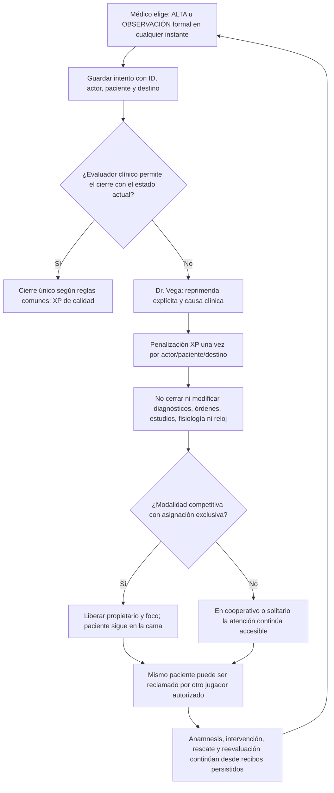

# ATRIA 5.0 — Contrato obligatorio para incorporar casos clínicos

**Ámbito:** exclusivamente `atria-5.0-core-rebuild-experimental`. No modificar ATRIA 4.8.7, `main` ni otras ramas.

## Regla de aceptación
Un caso nuevo **no está terminado** por mostrar síntomas, un diagnóstico y un tratamiento. Debe recorrer el motor clínico real, mantener coherencia fisiológica, admitir variaciones reproducibles, comunicarse por la anamnesis real y cerrar por la autoridad clínica. No crear motores paralelos, respuestas estáticas que evadan el motor ni excepciones por ID cuando existe una abstracción compartida.

## Cinco capas obligatorias y verificables

### Libertad clínica permanente

La capacidad técnica de ejecutar, la pertinencia clínica y el cumplimiento del
checklist son contratos distintos. La autoridad ejecuta una decisión interpretable
y técnicamente posible aunque sea innecesaria, precoz, repetida, excesiva o
contraindicada. Dosis, autor, paciente, vía y tiempos reales quedan en sus recibos.
Las reglas de pertinencia alimentan consejo y evaluación; nunca autorizan una
administración. Los límites físicos reales (vía no disponible, dispositivo o
formulación no implementados) deben explicarse. Las consecuencias se calculan en
el propietario fisiológico existente; no se inventa toxicidad para castigar una
orden. Una mala decisión sin daño puede reducir calidad y recompensa. Una muerte
requiere evidencia causal nativa vinculada a administraciones confirmadas antes
de descontar carrera al médico responsable; la enfermedad por sí sola y las
decisiones de un compañero no justifican ese descuento. Los reintentos de red no
son nuevas dosis ni nuevos descuentos. Dr. Vega recomienda; no concede permisos.

1. **Fisiología causal y temporal.** Definir estado basal y variables fisiológicas pertinentes; evolución con el tiempo, tratamiento adecuado, tratamiento tardío, omisión e iatrogenia. Los signos vitales, observaciones, complicaciones y recuperación deben derivar de la autoridad clínica existente. No conceder mejoría por una orden aún no ejecutada; respetar dosis, tiempos y dependencias. Comprobar también escenarios de deterioro y muerte cuando sean clínicamente plausibles.
2. **Contenido clínico y decisiones.** Definir motivo de consulta, anamnesis dirigida, antecedentes, examen físico por sistemas, estudios pertinentes, resultados interpretables, diagnósticos diferenciales, conducta y reevaluación. Evitar resultados contradictorios. Verificar que la enfermería, medicamentos, estudios y el docente utilicen los contratos existentes. La disposición final (alta, observación, UTI/derivación, cirugía u otro destino admitido) **cierra** el caso conforme a la autoridad clínica; no exigir evolución posterior al cierre.
3. **Variabilidad clínica reproducible.** Integrar el generador común de variaciones: identidad, edad y antecedentes cuando proceda, severidad, manifestaciones, evolución, comorbilidades y factores de riesgo. Usar semillas deterministas y persistencia en reconexión; las variantes deben seguir siendo clínicamente plausibles y no modificar hechos fijos incompatibles.
4. **Seguridad farmacológica y alergias.** Incorporar alergias y reacciones/intolerancias según el modelo existente, contraindicaciones, interacciones y riesgos relevantes, y verificar sus consecuencias clínicas. Nunca filtrar o inventar alergias por estilización conversacional; conservar la distinción entre alergia, intolerancia y reacción grave. Comprobar conducta correcta y conducta insegura con bots.
5. **Personalidad, anamnesis y comunicación.** Todo paciente nuevo debe **heredar automáticamente** el motor global de personalidad, rasgos multidimensionales, memoria de entrevista y relación por médico. Permitir un módulo opcional de expresiones específicas del caso (síntomas, vocabulario cotidiano, inquietudes y reacciones emocionales) que se combine con la personalidad global sin sustituir hechos clínicos. Las expresiones reutilizables pueden proponerse para el banco global mediante cambio explícito y pruebas; no alterar automáticamente conversaciones de otros casos. La hipoxemia, alteración neurológica o incapacidad verbal prevalece sobre el estilo. Evitar muletillas repetidas y respuestas idénticas con prefijos distintos.

## Integración técnica
- Reutilizar los contratos y módulos reales de `src/v5/content/`, `src/v5/clinical/`, `patient-variation.js`, `guard-patient-variation.js`, `patient-behavior.js`, `patient-dialogue.js` y `patient-observations.js` según corresponda; comprobar firmas actuales antes de programar.
- Añadir contenido mediante los mecanismos de registro/importación existentes, sin alterar los contratos de los casos previos.
- No introducir nuevas dependencias o un segundo motor de simulación cuando el actual resuelve la necesidad.
- Preservar comportamiento en Aprendiz, Solitario, Cooperativo y Competitivo; mantener identidad y personalidad entre turnos, médicos, reconexiones y checkpoints.

## Prueba de admisión de un caso adicional

Desde la raíz del repositorio, ejecuta la prueba del importador.

```bash
node --test --test-name-pattern='real CLI certification' scripts/import-clinical-case-pack.test.mjs
```

La prueba agrega `RESP-56` a una copia temporal del catálogo certificado de 55 casos mediante `--activate`. El cargador habitual abre esa copia y la selección «Patología específica» admite el caso en Aprendiz, Solitario, Cooperativo y Competitivo. El recorrido comprueba antecedentes generados por semilla, anamnesis, pista para la gasometría del caso, atención confirmada por enfermería, dos muestras nativas con informes independientes y cierre en Observación con un único recibo de XP. También recupera el estado guardado y reintenta los comandos de la primera muestra y del cierre.

La orden de observación activa (`/observacion`) mantiene al paciente en atención. El cierre deliberado con destino Observación (`/disposicion observacion`) exige los requisitos clínicos del caso y emite un recibo de cierre.

Para añadir un caso, toma una definición de `src/v5/content/packs/` como referencia y prepara el pack JSON. Ejecuta `node scripts/import-clinical-case-pack.mjs --pack CASOS.json` para compilarlo sin publicar. Copia el catálogo actual a una ruta de prueba y vuelve a ejecutar con `--activate --output CATALOGO-DE-PRUEBA.json`. Comprueba el recorrido real antes de actualizar el catálogo jugable. La matriz, los cierres y las entrevistas toman sus casos del catálogo certificado.

## Puerta de calidad para cada caso nuevo
1. Ejecutar bots sobre el caso real: entrevista completa y repreguntas; decisiones acertadas, tardías, erróneas y ausencia de intervención.
2. Comprobar evolución fisiológica temporal, cambios tras tratamiento **confirmado**, complicaciones, contraindicaciones, alergias, deterioro y cierres.
3. Probar varias semillas, perfiles de personalidad y variantes del caso; comprobar persistencia y ausencia de contradicciones.
4. Comparar conversaciones de pacientes del **mismo caso** con rasgos diferentes; asegurar diversidad perceptible sin perder hechos clínicos ni crear frases artificiales.
5. Ejecutar pruebas de regresión relevantes de los casos anteriores y CI de la rama; no repetir campañas masivas aprobadas si el cambio no afecta sus contratos.

**Criterio de entrega:** el nuevo caso queda jugable, fisiológicamente coherente, variable, seguro ante errores de tratamiento, conversacionalmente integrado y verificable por pruebas. Publicar commit, HEAD, pruebas efectivamente ejecutadas, CI y pendientes reales. Si falta alguna capa, declararla pendiente: nunca afirmar certificación integral.

**Evolución del sistema:** cada caso aporta variaciones locales; únicamente las generalizables, comprobadas y aprobadas por tests amplían el banco compartido. El motor global se mantiene compatible hacia atrás. No modificar la personalidad de casos anteriores como efecto colateral de importar uno nuevo.

---

## Protocolo de migración de enfermedades V2 (congelado como norma de trabajo, 21/11/2026)

### Objetivo y alcance

La V2 es **una nueva revisión de la MISMA enfermedad**, no un segundo simulador clínico. El caso V1, su fuente, las trazas de QA y las partidas que ya dependan de él se conservan. Crear una V2 en *candidato aislado* no modifica `src/v5/content/cases.json`, el catálogo activo `src/v5/content/certified-case-packs.json`, las políticas V1, ni los cuatro modos. No activar ni desplegar una candidata por el hecho de compilar.

**Foto exacta del catálogo actual:** 55 IDs únicos: 25 casos digestivos/abdominales de `src/v5/content/cases.json` y tres packs certificados de 10 (RESP-01..10, CARD-01..10, NEUR-01..10). **No confundir 55 casos con 55 ejecutores independientes**: el motor y sus políticas son compartidos. Los 30 de especialidad incluyen 23 casos con al menos una complicación declarada y 26 definiciones de complicación; el catálogo no exige una complicación en cada caso. Algunos casos digestivos tienen complicaciones manejadas por políticas distintas.

### Taxonomía cerrada de destinos, abierta en combinaciones

Se reconocen **seis destinos operativos ya existentes**. El conteo corresponde a los **55 casos**, según destinos posibles declarados en las reglas V1; NO son pacientes, eventos ni rutas exclusivas. Una enfermedad puede admitir varios destinos según gravedad y respuesta.

| Código de destino | Significado clínico de cierre | Casos que lo permiten (sobre 55) |
| --- | --- | ---: |
| `alta` | Tratamiento/seguimiento ambulatorio con estabilidad y señales de alarma | 9 |
| `observacion` | Vigilancia y reevaluación sin alta inmediata | 10 |
| `sala` | Internación y atención médica continuada | 24 |
| `uti` | Cuidados intensivos y soporte avanzado | 32 |
| `procedimiento` | Entrega a procedimiento/endoscopia/hemodinamia/drenaje según reglas reales | 12 |
| `quirofano` | Entrega al equipo quirúrgico y control del foco pendiente de realización | 9 |

La **aceptación por el receptor** es una condición del traslado, no un séptimo destino. El traslado aceptado **no acredita** que la cirugía o el procedimiento se hayan realizado. La muerte, el abandono, la atención incompleta y la inestabilidad son **desenlaces o estados**, nunca destinos válidos de alta. El motor puede seleccionar destinatario según presentación; una lista de destinos nunca concede permisos para una derivación insegura.

### Familias combinables de tratamiento (seis)

Cada V2 declara cero, una o varias de estas familias, sin crear un ejecutor nuevo por familia: **T1 vigilancia/observación y reevaluación**, **T2 terapia farmacológica** (oral/inhalada/IV con dosis, vía y tiempos), **T3 reanimación y soporte vital** (oxígeno, volumen, hemoderivados, vasopresores, ventilación), **T4 procedimiento no quirúrgico** (endoscopia, drenaje, descompresión, estimulación cuando corresponda), **T5 reperfusión/hemodinamia o intervención endovascular**, **T6 cirugía/control del foco**. El destino y el tratamiento NO son lo mismo. Una intervención puede ser necesaria antes del traslado, o ser responsabilidad del servicio que recibe: declarar cuál y cómo se verifica su ejecución o aceptación. Una orden posible pero errónea se puede ejecutar según la autoridad existente, sin aprobación del checklist; el daño solo se atribuye después de la ejecución confirmada.

### Cinco patrones de evolución a contemplar en el diagrama

**E0 curso basal sin intervención**, **E1 respuesta al tratamiento efectivamente ejecutado**, **E2 deterioro por enfermedad, omisión o demora**, **E3 complicación intercurrente o recurrencia por variante/semilla**, **E4 iatrogenia y posible rescate**. Cada transición especifica desencadenante, tiempo, signos/resultados, contraindicaciones, acciones de rescate, irreversibilidad y desenlace. No todos los casos requieren E3/E4 como episodio real, pero sí deben probarse las decisiones erróneas sin inventar daños no sustentados. Complicación resuelta, incompleta, muerte o cierre seguro son resultados del motor, no atajos del diagrama.

### Contrato ejecutable único y diagramas observacionales (23/11/2026)

Los grafos `clinicalGraph` de ATRIA V2 son una **proyección observable** del flujo clínico, nunca un segundo motor, un catálogo de autorizaciones ni un orden de acciones obligatorio. La autoridad para tratar, complicarse, rescatar, evolucionar, trasladar y otorgar XP vive en `clinicalPolicy` y en los ejecutores, recibos y tiempos nativos existentes. El compilador V2 **rechaza** un diagrama cuya rama de cierre no corresponda a un destino permitido y a un verdadero recibo de disposición; la aceptación del receptor no equivale al cierre ni puede encender dos desenlaces.

**Rescate declarativo AND/OR:** `rescueAllOf` significa completar todas las intervenciones; `rescueAnyOf` significa completar una de las alternativas. El único intérprete puro `clinical-rescue-logic.js` alimenta tanto la recuperación fisiológica nativa como los requisitos de cierre y las pistas de Dr. Vega. Los cuidados diferidos sólo se tienen por satisfechos en el flujo de transferencia aceptado que los documenta. Ningún heurístico general puede convertir un tratamiento alternativo autorizado en una segunda prescripción obligatoria por detectar simplemente una enfermedad o un signo aislado.

**Regla de escalabilidad:** las particularidades de una patología se declaran como datos clínicos validados; los contratos, las alternativas, la semántica del rescate y los destinos permanecen transversales. No crear decisiones `if (caseId === ...)` en módulos universales. Antes de aceptar otra V2, verificar que dos políticas con identidades distintas y las mismas reglas producen exactamente las mismas decisiones de rescate, que el diagrama corresponde a la política, y que un cierre único requiere un recibo auténtico.

### Diagrama de flujo obligatorio por enfermedad

Cada candidata V2 tendrá un **grafo de decisiones trazable** (no solamente una ilustración) con estos nodos de referencia, saltos urgentes permitidos y condiciones explícitas:

1. **Ingreso y triaje:** motivo, estabilidad, antecedentes, gravedad y variantes reproducibles.
2. **Anamnesis y examen:** preguntas por intención, memoria/persona, examen por sistemas y hallazgos.
3. **Hipótesis clínicas:** diferenciales, criterios de suficiencia e incertidumbres.
4. **Estudios:** indicación, muestras, latencia, resultados interpretables y medidas que NO pueden esperar el informe.
5. **Órdenes y enfermería:** tratamientos técnicamente ejecutables, dosis/vía, administración/recibo, latencias y alternativas compatibles.
6. **Evolución fisiológica:** funciones compartidas, respuesta causal temporal, complicación, iatrogenia, rescate, persistencia y reconexión.
7. **Reevaluación y Dr. Vega:** checklist dinámico real, una acción prioritaria, nombre exacto de control/orden, alternativas, XP y pistas repetidas, sin autoridad clínica adicional.

**Ampliación obligatoria — deterioro por omisión e iatrogenia (23/11/2026).** Un episodio aleatorio manifestado, el deterioro nativo por omisión/demora y un evento adverso realmente documentado deben traducirse a recomendaciones dinámicas de estabilización cuando exista una intervención nativa clínicamente respaldada. El selector no deduce causalidad de un valor aislado ni inventa antídotos; usar rasgos de la enfermedad, signos vitales y recibos de administración. La misma proyección de seguridad rige cierre y Dr. Vega. Mantener prioridad de anafilaxia, respetar estados pendientes/receptor, reconocer daños cuya reversión específica aún no está implementada y nunca prometer supervivencia. Probar especialmente hipoxemia por omisión, sangrado iatrogénico por anticoagulante y depresión respiratoria por opioide en las V2 candidatas; conservar V1 sin cambios. Esta regla no es un segundo motor ni altera umbrales de muerte.

### Cinco orígenes obligatorios de deterioro clínico y una sola autoridad de estabilización (23/11/2026)

**Contrato del usuario.** La simulación debe contemplar estas cinco fuentes de descompensación, que **no son categorías excluyentes**; una misma exposición puede ser tanto un tratamiento incorrecto como una contraindicación o una alergia, y una demora puede agravar cualquiera de ellas. El origen causal es distinto del **estado fisiológico** y de los **requisitos clínicos de rescate**. Nunca crear otro escritor de signos vitales, un motor de muerte, una bonificación/penalización de XP ni un plan de Vega con reglas de tratamiento paralelas.

1. **O1 — Aleatoriedad de la enfermedad.** La semilla selecciona sólo una *posibilidad* de complicación. Deben cumplirse las condiciones clínicas y temporales del caso antes de manifestarse el episodio nativo. El sorteo no decide una muerte inevitable; el motor calcula la progresión y la recuperación según dosis, tiempo, respuesta real y cuidados.
2. **O2 — Tratamiento incorrecto, excesivo o repetido.** Una acción técnicamente ejecutable puede ocasionar deterioro por sus efectos nativos si fue equivocada, sobredosificada, mal dosificada, inadecuada para el cuadro o repetida. El acumulado, la vía y el tiempo deben proceder de **administraciones únicas confirmadas**; un reintento de red con el mismo identificador nunca equivale a una segunda dosis. No toda equivocación produce lesión, y no toda repetición es un error. Identificar la exposición responsable y, si existe un mecanismo de reversión implementado, orientar hacia él más la estabilización de soporte.
3. **O3 — Contraindicaciones.** Una medicación o intervención puede ser posible técnicamente pero estar clínicamente contraindicada por la enfermedad, signos vitales, antecedentes, interacciones o condición actual. La **evaluación de pertinencia no bloquea** la libertad de prescribir. El daño corporal sólo aparece si el mecanismo fisiológico documentado demuestra una consecuencia; una contraindicación, por sí sola, puede penalizar la calidad de cierre sin inventar toxicidad. Ante daño confirmado, el rescate depende del agente y sus efectos reales.
4. **O4 — Alergia del paciente.** Usar únicamente alergias e hipersensibilidades propias de la variación y anamnesis, distinguiéndolas de intolerancias y reacciones leves. Una administración confirmada del desencadenante puede provocar anafilaxia o una reacción menor de acuerdo con la seguridad farmacológica nativa; la anafilaxia requiere prioridad máxima y rescate específico (adrenalina IM auténtica y soporte pertinente). No dar por resuelta la reacción por la mera solicitud de la medicación.
5. **O5 — Abandono, demora u omisión prolongada.** Sin intervenciones efectivas, la evolución basal de la enfermedad y el transcurso del **reloj clínico real** pueden causar descompensación. La gravedad procede de parámetros y trayectoria nativa, no de una orden ficticia de «morir tras X minutos». No atribuir abandono sólo porque pasó tiempo: distinguir cuidados y observación justificados, estudios pendientes, medicación en curso y negligencia sin atención. Aunque el deterioro sea reversible, un rescate tardío puede fracasar por el daño acumulado y el umbral de supervivencia ya existente.

**Transición universal, independiente del origen:** lesión o deterioro demostrado → valoración ABC y signos actuales → identificar causa(s) y evidencia disponible → elegir acción de rescate **implementada y apropiada para esa causa** → ejecutar en la autoridad real → esperar el recibo, evaluar latencia y reevaluar respuesta → continuar estabilización o escalar a servicio receptor → reanudar checklist y decisión de cierre si está seguro. Las pistas de Dr. Vega consultan esas mismas condiciones sin ejecutar nada; una medida de soporte (oxígeno, fluidos, transfusión) **no sustituye** un tratamiento causal de reversión no implementado (p. ej. depresión opioide, anticoagulación dañina, intoxicación). Si un antídoto, reversión, procedimiento o alternativa no existe en el formulário y ejecutor nativos, **registrar el déficit y no afirmar rescate completo**.

**Criterios verificables para cada V2:** probar las cinco vías *cuando sean clínicamente aplicables* en condiciones basal, manifestada, rescate temprano, rescate tardío, tratamiento imposible, recuperación parcial, muerte y combinación de orígenes; contrastar signos y recibos antes/después, no sólo texto del mentor. Verificar cambios de prioridad de Vega al producirse y resolverse la urgencia, ausencia de órdenes duplicadas, espera gratuita, anafilaxia prioritaria, independencia del sorteo, checkpoint/reconexión, causalidad de daño y XP sin castigar muerte por enfermedad. Repetir en Aprendiz, Solitario, Cooperativo y Competitivo. Las partidas V1 y el catálogo activo se conservan sin cambios.

**Estado auditado de las dos candidatas a 23/11/2026:** O1 cuenta con política de complicación nativa y prioridades de rescate; O2 tiene efectos adversos nativos para exposiciones concretas (incluido sangrado iatrogénico, depresión respiratoria y sobrecarga por volumen), pero **no** toda lesión dispone de una reversión causal; O3 detecta contraindicaciones para pertinencia y algunos daños, pero no cubre todas sus posibles consecuencias; O4 tiene anafilaxia y rescate IM modelados, sin pretender que toda alergia sea grave; O5 permite evolución clínica por demora y rescate en función de signos, pero requiere una certificación independiente de abandono prolongado y sus desenlaces. **Este contrato no es una afirmación de certificación completa de las cinco vías.**

**Implementación transversal inicial (23/11/2026).** `clinical-deterioration-causes.js` proyecta en lectura pura los cinco orígenes (random, treatment, contraindication, allergy, unattended) a partir de episodios nativos manifiestos, daños farmacológicos con recibos válidos, contraindicaciones asociadas a daño observado y progresión fisiológica sin terapia causal. El origen `unattended` es **progresión no tratada observada**, no una adjudicación automática de negligencia al médico. Las causas pueden coexistir sin duplicar el daño; una contraindicación sin lesión no fabrica una complicación. `clinical-stabilization-requirements.js` consume esa evidencia para los pilotos V2 y usa los mismos requisitos de seguridad del cierre y Dr. Vega. Tras soporte confirmado, una reacción grave activa aún impide alta hasta documentar su resolución nativa; traslados urgentes con receptor se rigen por sus propias normas. No existen por ello antídotos automáticos ni un motor universal de toxicología completo: cada mecanismo de reversión causal requiere implementación y certificación fisiológica real. Las regresiones de las cinco causas deben ejecutarse en el CI de pistas y los dos pilotos.

**Regla transversal obligatoria — rescate dinámico de complicaciones (23/11/2026).**
Si la autoridad fisiológica registra una complicación ya manifestada (no una posibilidad sorteada), Dr. Vega debe suspender la secuencia rutinaria de estudio/cierre y priorizar, mediante los mismos requisitos nativos de estabilización, la intervención de rescate clínicamente pertinente y ejecutable. Distinguir acciones confirmadas de órdenes pendientes: mientras un rescate se administra puede proponer las otras intervenciones imprescindibles, pero nunca duplicar la orden ni recomendar un alta/traslado prematuro; si todas las medidas de rescate están pendientes, indicar espera gratuita. Tras la recuperación fisiológica documentada, reanudar la secuencia normal según el estado y destino. Una alergia grave activa mantiene prioridad máxima, usando su rescate propio. La pista es lectura pura, no cambia signos vitales, administración, permisos de tratamiento, diagnóstico, mortalidad ni XP por sí misma. La selección aleatoria de una futura complicación **no** revela pistas de una crisis que aún no ocurrió. Regresión obligatoria en las V2 de neumonía (`RESP-01`) y hemorragia variceal (`VARIX-001`), más cualquier nuevo caso con deterioro recuperable. La regla vive en el selector compartido y consume los requisitos del evaluador canónico, no motores duplicados.
8. **Decisión final:** destinos permitidos por estado, aceptación del receptor, cierre único/XP, muerte/abandono y seguimiento.

Ramas mínimas de QA: manejo correcto; diagnóstico omitido o equivocado; orden técnicamente posible pero improcedente; manejo insuficiente; demora; sobredosis/contraindicación/alergia; complicación no resuelta y rescate; transferencia precoz o al destino incorrecto; reintento idéntico y reconexión; variantes y personalidades. Los pacientes **no reciben mejorías, estudios, administración ni XP por el simple clic**: únicamente mediante recibo/autorización y avance fisiológico real. Todas las ramas deben conservar la enfermería, las pistas y la historia clínica.

### Planilla canónica V2 (una enfermedad por ciclo)

La planilla tendrá una **fila índice por enfermedad** (ID lógico, fuente V1 y SHA, especialidad, V2 candidata, estado, destinos, familias T1–T6, patrones E0–E4, pruebas, enlace a diagrama, SHA de aprobación, rollback). La **ficha por variante** desarrolla: presentación/semilla; triaje y antecedentes; personalidad y anamnesis; examen; diferencial; estudios y tiempos; intervenciones/contraindicaciones; trayectoria vital basal; bifurcaciones con condiciones; complicaciones y tratamiento de rescate; criterios de reevaluación; pista de Vega por requisito de cierre; aceptación y destino; XP/penalizaciones; comparación V1→V2 y fuentes clínicas. El diagrama se define en datos de reglas verificables, no lógica ejecutora duplicada. Mantener una planilla versionada como índice único y anexos propios por caso: **no crear otro inventario paralelo de 55 pendientes**.

### Identidad, staging, activación y reversión: protección obligatoria

- Mantener **ID lógico de enfermedad estable** para el usuario, por ejemplo `RESP-01`, con campo de revisión `v1` / `v2-candidate` y fuente/SHA rastreables. Una candidata puede necesitar un ID temporal **solo en catálogo de pruebas aislado**, nunca mostrar dos entradas de la misma enfermedad en el catálogo activo.
- La implementación actual de `clinical-case-registry.js` es **append-only**, rechaza `id` duplicado y `packId` activo duplicado; `import-clinical-case-pack.mjs --activate` **publica**, no sustituye. **Todavía NO existe un selector V1/V2 certificado para reemplazar casos existentes.** No engañar al importador con un ID `-V2` y publicar ambos en el juego.
- Antes de la primera promoción diseñar y probar una **selección versionada atómica**, con V1 por defecto, V2 detrás de bandera OFF, nuevas guardias vinculadas a una revisión fija, partidas/reconexiones V1 conservadas, autoría/estado/recibos compatibles y rollback a V1. Si la selección segura no está implementada, **la V2 permanece en staging**.
- Importar con el pipeline existente, validar dependencias reales, certificar en Aprendiz/Solitario/Cooperativo/Competitivo, comparar V1 y V2 con semillas y perfiles, comprobar toda la fisiología/nursing/Vega y revisar indicaciones/dosis con fuentes médicas vigentes. No activar por apariencia ni por una sola prueba verde.
- Por cada cambio: commit pequeño a `atria-5.0-core-rebuild-experimental`, prueba específica y CI de SHA definitivo; cuando Vercel Hobby vuelva, Preview del MISMO SHA, Android y 2–4 médicos antes de liberar. **Nunca actualizar `main` ni producción directamente**; no inferir que Vercel recibió commits mientras el despliegue esté suspendido.

### Primer piloto propuesto, no activado

**`RESP-01` — NAC ambulatoria de bajo riesgo**, origen `atria-respiratory` V1.0.0. Es un caso ya certificado, una única ruta de alta, terapia farmacológica y sin complicaciones intrínsecas declaradas en ese pack: útil para comprobar la maquinaria V1→V2 (planilla, diagrama, anamnesis, variaciones, medicación, pista, firma de recibos y rollback) con mínimo riesgo. **No se ha creado ni activado V2**. El segundo piloto, cuando el mecanismo esté validado, puede ser `RESP-02` (sala/UTI, soporte avanzado, dos complicaciones), para demostrar que el flujo admite bifurcaciones y rescates. El orden clínico definitivo puede ajustarse sin afectar el contrato.

**Puerta de avance:** diseñar el primer caso V2 aislado ya es posible; **activarlo públicamente no** hasta contar con selector versionado verificado, estabilidad de plataforma y Preview de Vercel/Android real.

## Contrato transversal del flujo clínico y receptor ciego a la verdad (21/11/2026)

**Estado:** norma de diseño y casos de prueba, NO implementación certificada. Mantener las 55 enfermedades V1, el único motor de fisiología, cierre/XP y autoría de recibos. No tocar main, V4, producción ni activar V2.

### Regla central: tres decisiones separadas

- **Verdad oculta:** diagnóstico real, semilla, variantes, deterioro, fisiología, resultados y daño causal pertenecen al motor autoritativo y evaluación final. Jamás se filtran a los servicios receptores.
- **Criterio del receptor:** se decide SOLO con diagnóstico presuntivo escrito por el jugador, hallazgos y resultados comunicados, signos vitales reales, tratamientos administrados, preparación mínima, riesgos vigentes, capacidad y pertinencia del servicio. Dos condiciones: (1) indicación declarada compatible con servicio y datos visibles; (2) preparación mínima de transferencia suficiente. La aceptación de receptor es una tercera confirmación asíncrona, no una operación realizada.
- **Puntuación al cierre:** tras recibir aceptación o alta válida, contrastar contra verdad y recibos para diagnóstico, anamnesis, examen, estudios, tratamiento, eficiencia, latencias, omisiones e iatrogenia. Aceptar un traslado NO valida la exactitud del diagnóstico: diagnóstico falso puede resultar en cero XP o penalización causal, sin anular retroactivamente la recepción. No crear otro scorer.

### Grafo general de decisiones (no fuerza secuencia de acciones)

~~~mermaid
flowchart TD
  A["Paciente ingresa: enfermedad real oculta"] --> B["Atención libre: signos, anamnesis, examen, estudios"]
  B --> C["Impresión presuntiva escrita y editable"]
  B --> D["Órdenes y administración real"]
  D --> E["Fisiología temporal: respuesta, omisión, complicación, iatrogenia o muerte"]
  E --> B
  C --> F["Solicitar destino: alta, observación, sala, UTI, procedimiento, quirófano"]
  D --> F
  F --> G{"¿Destino sin receptor externo?"}
  G -- Sí --> H{"¿Seguridad, condiciones de cierre y plan suficientes?"}
  G -- No --> I{"¿Impresión declarada y evidencia visible justifican el servicio?"}
  I -- No --> J["Rechazo con motivo; diagnóstico o destino pueden corregirse"]
  I -- Sí --> K{"¿Estudios indispensables y preparación mínima completos?"}
  K -- No --> L["Rechazo con faltantes de preparación, sin cierre"]
  K -- Sí --> M["Consultar receptor, esperar respuesta y registrar aceptación"]
  M --> N["Cierre único del cuidado inicial"]
  H -- Sí --> N
  H -- No --> L
  L --> B
  J --> B
  N --> O["Evaluación contra verdad oculta y recibos"]
  O --> P["XP/descuentos/penalización; un solo recibo"]
~~~

La fisiología y las tareas continúan en paralelo durante entrevistas, estudios y esperas. En urgencia no se retrasan acciones salvadoras para completar etapas optativas del diagrama.

### Comportamiento universal por caso

1. **Anamnesis:** permitir todo el vocabulario de preguntas y repreguntas del juego a cualquier paciente; mantener respuestas coherentes con sus hechos, edad, variante, gravedad, memoria y capacidad de responder. Lo irrelevante no bloquea; no preguntar temas importantes reduce calidad, pero no debe bloquear arbitrariamente cierre si están garantizados seguridad y destino.
2. **Estudios, examen y tratamientos:** todos los controles y catálogos globales están disponibles para todos los pacientes aunque la elección no esté indicada. No inventar resultado ni administración para una capacidad aún no modelada. Los estudios dirigidos informan, los omitidos reducen calidad salvo que sean indispensables para seguridad/destino, y los innecesarios consumen recursos y pueden descontar XP. No penalizar estudios razonables del diferencial o de cambios clínicos.
3. **Diagnóstico presuntivo:** debe registrarse antes de cierre electivo, no completarse automáticamente con la verdad. La recepción interpreta impresión y datos compartidos. La puntuación final compara contra diagnóstico real. Excepción urgente, sindromática o de incapacidad solamente con criterio público y trazable, nunca con acceso al diagnóstico oculto.
4. **Farmacología:** medicamento administrable no significa indicado. Fármacos condicionales o diferidos, como antibióticos, deben acreditar una intervención y modificar la evolución solo por mecanismos y ventanas autoradas; los expansores, oxígeno y soporte actúan según dinámica real, dosis y contexto. Ni antibiótico cura instantáneamente ni marcar orden mejora vitales. Omisión, exceso, alergia, error y retraso pueden producir deterioro real, con recuperación y rescate plausibles.
5. **Dos niveles de requisito:** A) bloqueantes por seguridad o recepción (indicación declarada, pruebas indispensables según gravedad/urgencia, estabilización mínima, tratamiento urgente, confirmación receptor); B) oportunidades para calidad (anamnesis adicional, examen/estudio orientador no indispensable, eficiencia, precisión). La falta de B nunca impide por sí sola cierre. Estabilizar para transporte NO exige curar definitivamente una enfermedad antes de que la trate el receptor.
6. **Cierres:** conservar los seis destinos oficiales. Observación activa no es cierre formal en observación. Traslado aceptado cierra cuidado inicial, sin ejecutar automáticamente cirugía, reperfusión o endoscopia. Rechazo deja caso abierto y reintentable. Un UID, un cierre y un premio idempotente.
7. **Dr. Vega:** leer requisitos pendientes y recibos del MISMO evaluador de cierre, sugerir una única acción realizable con control exacto o espera gratuita. No revelar verdad clínica, no puntuar y no confundir recomendaciones opcionales con bloqueos. Repetir pista no vuelve a penalizar.

### Pruebas obligatorias del receptor y de puntuación

| Impresión comunicada | Preparación mínima | Veredicto de recepción | Resultado posterior |
| --- | --- | --- | --- |
| Indicación compatible y diagnóstico verdadero | suficiente | aceptar | calidad según conducta |
| Indicación compatible pero diagnóstico falso frente a verdad oculta | suficiente, sin contradicciones ostensibles comunicadas | **puede aceptar sin conocer verdad** | cero crédito de diagnóstico y potencial XP nula/negativa por daño o error según política de puntuación |
| Indicación compatible | insuficiente | rechazar con faltantes concretos | no cerrar |
| Indicación incompatible con servicio | suficiente o no | rechazar indicando falta de indicación | no cerrar |
| Ausencia de impresión | cualquiera | rechazar cierre electivo salvo vía sindromática urgente explícita | nunca adivinar diagnóstico |
| Datos comunicados contradicen de manera clara la impresión | cualquiera | rechazar o exigir aclaración motivada por evidencia visible | no inferir rechazo por ID oculto |

Ejemplo: paciente con enfermedad real distinta de apendicitis, diagnosticado erróneamente como apendicitis. Cirugía puede recibirlo si la indicación y preparación son defendibles desde lo conocido por el receptor, y el médico pierde calidad/XP al contrastar con la verdad. En cambio escribir una patología que no requiere intervención quirúrgica no basta para conseguir recepción. Estudios contradictorios **visibles** sí justifican duda o rechazo.

### Diferencia detectada en el motor vigente y protección de regresiones

El sistema **ya** soporta consultas asíncronas, preparación, estabilización, recibos, penalización por estudios extras, respuestas de Dr. Vega y XP únicos. No reconstruirlo. Pero en src/v5/clinical/consultation-evidence.js la compatibilidad aún se calcula con assessDiagnosticImpression(c, p.diagnosis), donde c es la enfermedad real; src/v5/clinical/surgical-consultation.js también limita las rutas y servicios usando c.clinicalPolicy/caseId. Una excepción ya acepta discrepancia diagnóstica en ciertas urgencias con estudios confirmados. **Todavía no existe prueba suficiente del contrato general de recepción ciega al diagnóstico verdadero**. Separar el modelo de recepción por datos visibles del evaluador real de calidad y mantener salvaguardas por evidencia objetiva, gravedad y recursos sin abrir bypass general. No modificar tests clínicos históricos para ocultar discrepancias.

### Matriz de migración y certificación individual de 55 casos

Aplicar en una única planilla C1, una enfermedad/revisión por ciclo, sin duplicar inventarios: 25 casos digestivos + 10 respiratorios + 10 cardiológicos + 10 neurológicos. Los 550 recorridos históricos de bots verifican la arquitectura previa, **no** este contrato nuevo.

Por cada caso, y variantes con semillas distintas:
- Anamnesis completa, omisa y de intención global, examen y estudios pertinentes/irrelevantes, diagnóstico exacto/sindromático/erróneo.
- Tratamiento correcto, alternativo, ausente, tardío, excesivo o contraindicado, con signos vitales, recibos y recuperación comprobables.
- Alta, observación, sala, UTI, procedimiento o quirófano según la impresión declarada y la capacidad del receptor; aceptación/rechazo basados en evidencia comunicada y preparación mínima.
- Cierre con bajo puntaje sin bloquear por anamnesis opcional; estudios extras penalizados pero diferenciales razonables no; error grave diagnóstico penalizado tras aceptación; imposibilidad de cerrar tras rechazo.
- Pistas Dr. Vega para cada faltante real, espera/repetición gratuita; pruebas de dos médicos, reintento idéntico, reconexión, cierre/XP único y no ejecución ficticia del procedimiento receptor.
- Guardar para cada prueba ID/semilla/versión/SHA, acción, evidencia, respuesta receptor, signos, puntuación, fallo o éxito, y rollback. CI del SHA antes de Preview Android físico.

**Puerta de implementación:** primera contraprueba cruzada con APP-001 y un paciente no quirúrgico diagnosticado como apendicitis; después RESP-01 V2 aislado. Revisar antes de modificar las rutas GI heredadas y los casos con urgencias de recepción objetiva. No activar V2 ni reescribir en masa los 55 casos hasta cerrar contrato y regresiones.

## Enmienda: decisión libre de alta u observación y sanción de Dr. Vega (21/11/2026)

**La interfaz nunca impide intentar una decisión médica equivocada.** En cualquier caso, el médico puede solicitar ALTA o cierre formal en OBSERVACIÓN, incluso sin haber terminado la evaluación. La autorización real se calcula desde el evaluador común y los recibos, no desde la apariencia del botón ni desde un bloqueo previo del menú.



**Distinción obligatoria:** la acción de **vigilancia activa** (case.observe, /observacion) registra que se observa al paciente *sin cerrar el caso*. No es un intento de trasladar al paciente al destino formal Observación y no merece reprimenda. La decisión de **cierre formal** (/disposicion observacion) sí se evalúa como un intento definitivo y, si no cumple seguridad y destino, recibe Dr. Vega y penalización.

**Sanción durable:** conservar las claves históricas de alta insegura y admitir una clave específica para Observación insegura. La política vigente impone una sola multa de 15 XP por destino erróneo, actor y paciente; repetir el mismo intento no duplica el cargo. Si todavía no hay XP, registrar deuda y descontarla cuando se obtengan recompensas posteriores: saldo visible no negativo, deuda persistida. El mensaje identifica la sanción, permite continuar y comunica los requisitos clínicos incumplidos.

**Multijugador:** en Competitivo, el rechazo de cualquiera de los dos cierres libera el reclamo exclusivo y el foco; el UID, la cama, los resultados, las órdenes en curso, los signos y el historial quedan intactos para que otro jugador se acerque y lo reclame. En Cooperativo, los otros médicos autorizados ya comparten la atención; el rechazo nunca desconecta al paciente ni cancela la enfermería. El siguiente intento siempre se reevaluará con las nuevas evidencias.

**Estado:** lógica implementada en la rama experimental. Las pruebas de conversación, persistencia, rebuke, deuda XP y propiedad multijugador son obligatorias antes de declarar esta enmienda certificada en CI; la versión V1 activa no se reemplaza ni se publica en HTML privado hasta pasar todas las regresiones.

**Puerta de persistencia de cuenta online:** el ledger de la sesión y su checkpoint ya admiten `clinical.unsafe-observation` y la deuda futura de XP, pero la función SQL desplegada `atria_v5_award_verified` del esquema de Supabase (según la migración versionada más reciente del repositorio) solo verifica `clinical.unsafe-discharge` y topa el descuento según XP actual. **No afirmar que la sanción nueva se acredita de forma persistente en la cuenta online**, ni publicar esta revisión, hasta disponer de migración SQL segura, backfill/compatibilidad, verificación del RPC real con ambos tipos de error y pruebas de saldo/deuda del actor. No ejecutar una migración sobre producción como parte de un test clínico de staging.
