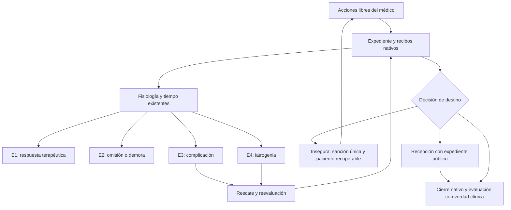

# RESP-01 V2 · Cobertura del grafo nativo

40/40 escenarios históricos V2, 15 pares V1/V2 sin errores y 8/8 recorridos adicionales; cuatro modos. Se observaron las 27 aristas declaradas. Esto no certifica todas las combinaciones clínicas ni Android físico. Un resultado adverso legítimo conserva su estado; no se convierte en fallo de software por acabar en muerte.

El grafo es declarativo, observacional y no bloqueante. Sus etiquetas de origen/desenlace aportan contexto; las acciones pueden ocurrir en otro orden. Los guardas se verifican sobre el estado y los recibos reales del ejecutor existente. No hay un reloj, fisiología o puntuación nuevos.

El esquema resume relaciones; las aristas auditables son las de la tabla. E0 es el ingreso basal. El médico puede solicitar estudios, tratar o decidir un destino antes de completar el resto; ni el dibujo ni su observador bloquean acciones. El fallecimiento es un desenlace nativo irreversible probado, no una arista de éxito forzada.

| Arista | Relación | Predicado observado | Modos con evidencia | Primer recorrido |
|---|---|---|---|---|
| triage | encounter → triage | `measured` | solo, apprentice, coop, competitive | 40/solo-competent |
| history | encounter → history | `history` | solo, apprentice, coop, competitive | 40/solo-competent |
| examination | encounter → exam | `examined` | solo, apprentice, coop, competitive | 40/solo-competent |
| hypothesis | encounter → hypothesis | `hypothesis` | solo, apprentice, coop, competitive | 40/solo-competent |
| study-request | hypothesis → studies | `ordered` | solo, apprentice, coop, competitive | 40/solo-competent |
| study-result | studies → results | `results` | solo, apprentice, coop, competitive | 40/solo-competent |
| nursing-pending | encounter → nursing | `nursing` | solo, apprentice, coop, competitive | 40/solo-competent |
| administration | nursing → treated | `administered` | solo, apprentice, coop, competitive | 40/solo-competent |
| time | encounter → evolution | `elapsed` | solo, apprentice, coop, competitive | 40/solo-competent |
| deterioration | evolution → complication | `complication` | solo, apprentice, coop, competitive | 40/solo-slow |
| iatrogenia | treated → iatrogenia | `iatrogenia` | solo, apprentice, coop, competitive | 40/solo-wrong-medication |
| rescue | complication → rescue | `rescued` | solo, apprentice, coop, competitive | 40/solo-slow |
| reevaluation | evolution → reassessment | `reassessed` | solo, apprentice, coop, competitive | 40/solo-competent |
| vega | encounter → mentor | `mentor` | solo, apprentice, coop, competitive | extra/solo-unsafe-destinations-dose-allergy-rescue-hint-recovery |
| unsafe-alta | encounter → unsafe | `unsafeAlta` | solo, apprentice, coop, competitive | extra/solo-unsafe-destinations-dose-allergy-rescue-hint-recovery |
| unsafe-observation | encounter → unsafe | `unsafeObservation` | solo, apprentice, coop, competitive | extra/solo-unsafe-destinations-dose-allergy-rescue-hint-recovery |
| unsafe-recoverable | unsafe → recoverable | `recoverable` | solo, apprentice, coop, competitive | extra/solo-unsafe-destinations-dose-allergy-rescue-hint-recovery |
| receiver-request | reassessment → receiver | `requestedReceiver` | solo, apprentice, coop, competitive | 40/solo-complication-rescue |
| receiver-accepted | receiver → accepted | `acceptedReceiver` | solo, apprentice, coop, competitive | 40/solo-complication-rescue |
| receiver-rejected | receiver → rejected | `rejectedReceiver` | solo, apprentice, coop, competitive | 40/solo-complication-rescue |
| close-alta | reassessment → alta | `alta` | solo, apprentice, coop, competitive | 40/solo-competent |
| close-observation | reassessment → observacion | `observacion` | solo, apprentice, coop, competitive | extra/solo-legal-observation |
| close-ward | accepted → sala | `sala` | solo, apprentice, coop, competitive | 40/solo-complication-rescue |
| unsupported-destination | encounter → unsupported | `unsupportedDestination` | solo, apprentice, coop, competitive | extra/solo-unsafe-destinations-dose-allergy-rescue-hint-recovery |
| death | evolution → death | `death` | competitive | 40/competitive-wrong-medication |
| checkpoint | encounter → recovery | `recoveredCheckpoint` | solo, apprentice, coop, competitive | 40/solo-competent |
| xp-once | encounter → reward | `reward` | solo, apprentice, coop, competitive | 40/solo-competent |

Los seis destinos están declarados: alta, observación y sala tienen recorridos válidos; UTI, procedimiento y quirófano tienen rechazo probado en este piloto sin indicación comunicada pertinente. No se prohíbe que una hipótesis distinta con evidencia pública justifique otro servicio; el diagnóstico verdadero se reserva a evaluación/XP.

E0–E4 describen basal, tratamiento, demora, complicación e iatrogenia/rescate. T1–T3 son aplicables aquí; T4–T6 quedan declarados no aplicables (sin procedimiento, reperfusión o cirugía indicados).

La matriz original de 40 dejaba seis aristas sin cobertura: Vega, alta insegura, observación insegura, continuidad tras reprimenda, observación legal y destino no indicado. Los ocho recorridos adicionales aportan esa evidencia; no se atribuye al run histórico.

Cada recorrido conserva semilla, estado inicial, comandos, relojes, cambios fisiológicos, recibos de administración, complicaciones, recuperación, destino, calidad, XP y sanciones en [evidencia nativa comprimida](evidence/resp01-v2-graph-2026-11-22/native-evidence.jsonl.gz). Ver [resumen](evidence/resp01-v2-graph-2026-11-22/summary.json). La prueba de dosis excesiva administra realmente morfina8 mg en una alergia grave seleccionada por semilla ordinaria; el rescate es adrenalina/oxígeno con recibos propios. Cero dosis es rechazo técnico, no una dosis inventada.

La certificación automatizada es distinta de una partida manual. El HTML se prueba por separado desde file:// con controles reales y reloj real. Los enlaces de CI/SHA y decisiones GO se actualizan en el [registro de misión](ATRIA-5-REGISTRO-HISTORICO-JUGABILIDAD-V2-OFFLINE-2026-11-21.md); el [inventario maestro](ATRIA-5-REMAINING-TASKS.md) es la única fuente de estado de los 88 IDs.
