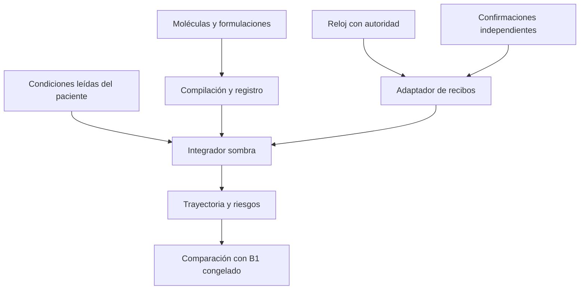

# ATRIA4.8.7 — Infraestructura farmacológica extensible

Estado: **sólo simulación aislada**. HEAD inicial remoto `67b6a78196c09ae568b8d7208f4e4d734a5bb47b`, CI inicial `38104457917` SUCCESS. El piloto B1 y sus snapshots aprobados se conservan. Esta entrega registra siete mecanismos para las cinco intervenciones B1; no implementa los otros25 tratamientos, no instala un ejecutor real y no otorga validación clínica.

## Qué cambió y quién calcula

- Evidencia del código: el integrador experimental es el único escritor del estado sombra. Los módulos reciben sólo ejes declarados congelados y devuelven parches comprobados, incluidos los riesgos. Los cálculos nativos y todas sus capas anteriores conservan la propiedad del paciente real. No existe un puente de escritura hacia ellos.
- Ingeniería: registro por ID, orden topológico estable, validación en compilación, procesamiento por exposición/vínculo activo y separación entre solicitudes y recibos confirmados. No se recorre el catálogo instalado en cada actualización.
- Diseño aún sujeto a validación: las dependencias faltantes del informe son propuestas de mecanismos/ejes; la mera presencia de un eje o una ficha regulatoria no demuestra una respuesta clínicamente calibrada.



`src/clinical/pharmacology-mechanisms-b1-487.js` contiene `volume`, `pressor`, `opioid-analgesia`, `opioid-respiratory`, `opioid-circulation`, `oxygenation` y `diuretic`. Morfina comparte una exposición entre tres efectos. La separación permite nuevos vínculos sin añadir condiciones por enfermedad al integrador; conserva la limitación B1 de un mismo compartimento temporal para analgesia y efecto SNC.

## Contrato ejecutable y ejemplo de extensión

El nuevo punto de entrada es `compilePharmacologyContent487(content, {mechanisms, axes, modelVersion})`. El adaptador `compilePhysiologyDefinitions487` sólo conserva el contrato B1 anterior. Una formulación define vía, administración, unidades y PK; su molécula define identidad y su lista `effects` vincula mecanismos instalados. El compilador rechaza identificadores repetidos, mecanismos/ejes ausentes, PK desconocida, parámetros inválidos, vínculos duplicados y fases incompatibles con su entrada.

El siguiente ejemplo es **sintético**, utiliza parámetros B1 heredados sólo para probar equivalencia y no constituye la ficha clínica de otro opioide:

```js
import {compilePharmacologyContent487, createB1PharmacologyContent487}
  from "../src/clinical/pharmacology-content-487.js";
import {PILOT_DRUGS_487, PILOT_DEFINITIONS_487, PHYSIOLOGY_AXES_487, PHYSIOLOGY_MODEL_487}
  from "../src/clinical/physiology-pilot-definitions-487.js";
const content = createB1PharmacologyContent487(PILOT_DRUGS_487);
const molecule = structuredClone(content.molecules.find(x => x.id === "morphine"));
const formulation = structuredClone(content.formulations.find(x => x.id === "morphine"));
molecule.id = molecule.activeMoiety = "qa-reused-opioid";
molecule.label = "Synthetic fixture, not a clinical drug";
formulation.id = "qa-reused-opioid-iv";
formulation.moleculeId = molecule.id;
delete formulation.legacy;
formulation.effects = [
  {mechanismId: "opioid-analgesia", parameters: {gain: 1}},
  {mechanismId: "opioid-respiratory", parameters: {gain: 1}},
  {mechanismId: "opioid-circulation", parameters: {gain: 1}},
];
content.molecules.push(molecule); content.formulations.push(formulation);
const definitions = compilePharmacologyContent487(content, {
  mechanisms: PILOT_DEFINITIONS_487.mechanisms,
  axes: PHYSIOLOGY_AXES_487, modelVersion: PHYSIOLOGY_MODEL_487,
});
// stepPhysiology487(existingShadowState, confirmedEvents, explicitMinutes, definitions)
```

Las pruebas ejecutan esa molécula en PERI-SEC/HDA/CIRR, dos formulaciones con vía/PK distintas, dos agentes con el mismo mecanismo y un mecanismo sintético sobre un eje ya existente. No modifican el núcleo para reconocer la nueva identidad. Los ejemplos clínicos futuros deberán sustituir identidad, unidades, PK, dosis, evidencia y calibración; reutilizar código no autoriza copiar la dosis de morfina.

Cada módulo declara `version`, `input`, `requires`, `reads`, `writes`, `kineticKinds`, `doseUnits`, parámetros acotados, dependencias, fases, `riskCodes`, evidencia y referencias de tests. Las referencias declaradas no ejecutan ni acreditan por sí solas las pruebas. Cambiar un handler o acumulador exige aumentar `mechanism.version`; la firma exacta de metadatos no detecta una edición de código sin versionado. El CI debe revisar ese contrato de mantenimiento. Una revisión activa de contenido/versiones exige replay explícito.

Una ficha con un nuevo eje no disponible se rechaza indicando su nombre. Añadir un eje real requiere su contrato de dominio, inicialización, evolución y observación independientes; esta entrega no instala un sistema genérico de nuevos órganos.

## Recibos, reloj y compatibilidad

`adaptConfirmedPharmacologyEvents487(events, {patientId, definitions, confirmations, clock})` sólo transforma entregas respaldadas por una confirmación independiente suministrada. Comprueba paciente, formulación, vía, dosis/unidad, acción, secuencia, tiempo y procedencia. `administration` corresponde a `bolus/start`; `dose-change` a `setRate`; `suspension` a `stop`. Estados pending/requested/cancelled/failed se informan sin efecto. El ledger es la frontera de confianza: comparar documentos no prueba físicamente una administración.

```js
const receipt = {
  schemaVersion: 1, eventId: "qa-dose-1", patientId: "qa-patient",
  treatmentId: "morphine", eventType: "administration", status: "administered",
  action: "bolus", route: "iv", sequence: 1, dose: {amount: 4, unit: "mg"},
  timestamp: {authorityId: "qa-session", unit: "clinical-minute", value: 0},
  verification: {source: "qa-confirmed-ledger", receiptId: "qa-confirmation-1"},
};
// QA fixture only. A separate matching confirmation row is mandatory.
```

El estado fija protocolo de recibos y autoridad. Recibos antiguos y tipados no se mezclan en una trayectoria; secuencias conflictivas entre lotes y cambios de procedencia se rechazan. Repetir un recibo idéntico no vuelve a aplicar su efecto; el orden de propiedades JSON no modifica su identidad. Suspender un bolo no borra lo ya administrado. Una modificación de tasa confirmada representa una tasa entregada absoluta; este contrato no prueba una historia completa start→titrate→stop. El adaptador vivo necesitará historia íntegra e identidad de episodio antes de aceptar esas acciones.

`createClinicalClock487`, `advanceClinicalClock487` y `nativeToClinicalTime487` registran explícitamente segmentos normal/typing: ritmo nativo0.12/0.03 minutos por segundo real, convención de guardia1 minuto clínico por segundo real activo. No modifican ninguno de los relojes del juego. Pausas, autoridad, historial, unidades y fracciones se verifican sin Date.now ni azar; conversión por segmentos, no división fija cuando hubo typing.

Compatibilidad: se conservan API B1 y resultados numéricos, no se promete reanudación directa de snapshots antiguos que carecen de protocolo/secuencias. Deben recrearse y reproducirse los eventos con el mismo manifiesto. Siguen vigentes el límite de2048 recibos y128 segmentos del reloj; al excederlos se exige checkpoint/replay, sin eliminación silenciosa de historia. La historia nativa de80 filas y la ausencia de suspensiones completas siguen bloqueando un observador vivo fiable. No se instala autoridad multijugador.

La PK sigue reducida y normalizada. Oral/IM admiten una formulación con inicio diferido; no hay absorción/biodisponibilidad validada ni composición de varios principios activos. Una combinación fija con PK por componente no equivale a varios mecanismos compartiendo una sola exposición. Un inicio distinto de cero en infusión se rechaza hasta modelarlo expresamente.

## Cobertura actual de las30 entradas

Inventario obtenido del arranque nativo actual post-V19, con13 casos:5 definiciones ejecutables exclusivamente en sombra y25 no implementadas. El adaptador global anterior conserva su rechazo por `anticoagulation`: sus29 reglas antiguas no equivalen a30 tratamientos validados ni a25 mecanismos nuevos. La cobertura JSON incluye aliases, mecanismos/ejes reutilizables, dependencias faltantes, identidad, eventos y responsable de efectos por entrada.

| Entrada | Tipo de contenido | Reutilización o requisito principal | Estado sombra |
|---|---|---|---|
| `oxygen` | gas | oxygenation; retención de CO₂ pendiente | B1 aislado |
| `fluid` | clase de fluidos | volume; resolver composición del fluido | B1 aislado |
| `albumin` | biológico | Compartimentos existentes; faltan oncótica/permeabilidad | No implementado |
| `vasopressor` | clase | pressor; B1 es noradrenalina | B1 aislado |
| `morphine` | molécula | 3 mecanismos opioides; endpoints por calibrar | B1 aislado |
| `analgesia` | clase | Opioides reutilizables sólo tras separar fentanilo/paracetamol | No implementado |
| `antiemetic` | clase | Separar agentes; náusea, motilidad y QT | No implementado |
| `ppi` | clase | Separar agentes; acidez, coágulo y sangrado dinámico | No implementado |
| `transfusion` | hemoderivado | Volumen compartido; Hb/contenido O₂ y producto entregado | No implementado |
| `paracentesis_ter` | procedimiento | Volumen compartido; ascitis/presión y procedimiento realizado | No implementado |
| `espironolactona` | molécula | Volumen/riñón compartidos; aldosterona, Na/K y respuesta lenta | No implementado |
| `steroid` | clase | Inflamación compartida; agente, inmunidad/glucosa y latencia | No implementado |
| `aza` | molécula | Infección compartida; inmunidad/médula y semanas | No implementado |
| `ceftriaxone` | molécula | Infección/PK comunes; susceptibilidad/exposición y toxicidad específica | No implementado |
| `metronidazole` | molécula | Infección/PK comunes; susceptibilidad/exposición y toxicidad específica | No implementado |
| `imipenem` | combinación | Infección/PK comunes; susceptibilidad/exposición y toxicidad específica; composición y PK por componente | No implementado |
| `ceftazidime` | molécula | Infección/PK comunes; susceptibilidad/exposición y toxicidad específica | No implementado |
| `cefoperazone` | molécula | Infección/PK comunes; susceptibilidad/exposición y toxicidad específica | No implementado |
| `cefepime` | molécula | Infección/PK comunes; susceptibilidad/exposición y toxicidad específica | No implementado |
| `piptazo` | combinación | Infección/PK comunes; susceptibilidad/exposición y toxicidad específica; composición y PK por componente | No implementado |
| `ampicillin` | molécula | Infección/PK comunes; susceptibilidad/exposición y toxicidad específica | No implementado |
| `amikacin` | molécula | Infección/PK comunes; susceptibilidad/exposición y toxicidad específica | No implementado |
| `gentamicin` | molécula | Infección/PK comunes; susceptibilidad/exposición y toxicidad específica | No implementado |
| `fluconazole` | molécula | Infección/PK comunes; susceptibilidad/exposición y toxicidad específica | No implementado |
| `amphotericin` | molécula | Infección/PK comunes; susceptibilidad/exposición y toxicidad específica | No implementado |
| `source_control` | procedimiento | sourceControlled compartido; foco y realización confirmada | No implementado |
| `stop_beta_blocker` | suspensión | Recibo stop reutilizable; identificar exposición destino | No implementado |
| `furosemide` | molécula | diuretic; balance/electrolitos pendientes | B1 aislado |
| `beta_blocker` | clase | Bomba/tono compartidos; cronotropismo/conducción/portal | No implementado |
| `anticoagulation` | molécula | Coagulación, trombosis, plaquetas, aPTT, sangrado/HIT | No implementado |

Cirugía: se inspeccionó `src/integration/surgical-nursing-487.js`: las órdenes habituales se redirigen a una consulta, no a una operación completada. El futuro mecanismo exige un recibo procedure-performed/source-addressed; no se supone que consultar Cirugía controle el foco. Ninguna ruta quirúrgica cambia en esta entrega.

La propuesta de estados nuevos se basa en dependencias fisiológicas y límites comprobados del motor. Para espironolactona y heparina, las fichas regulatorias respaldan respectivamente la necesidad de monitorizar función renal/potasio y coagulación/plaquetas; no proporcionan los coeficientes de un simulador. Referencias: [DailyMed espironolactona](https://dailymed.nlm.nih.gov/dailymed/lookup.cfm?setid=3487305c-25a6-4e82-923c-3e4dd638c988), [DailyMed heparina](https://www.dailymed.nlm.nih.gov/dailymed/drugInfo.cfm?setid=9ea0a519-dc7c-42e3-939e-2a7c80eedd25). Revisión clínica por agente sigue siendo obligatoria.

## Validación y coste observado

-19 controles de extensibilidad y30.351 comparaciones numéricas contra las trayectorias B1 aprobadas, sin regenerar los fixtures. Tolerancia absoluta1e-8+relativa1e-10. Incluyen riesgos y exposición, no sólo signos finales.
-7 controles de reloj,12 de recibos y8 de cobertura; pruebas de definición activa/versiones, ejes/PK/fases incompletos, riesgos fuera de contrato y escritura inválida fallan explícitamente.
- Suite completa existente, incluido el bot B1 ya aprobado, snapshots nativos, supervivencia/rescate y Cirugía; build y verificación del artefacto se ejecutan en cada checkpoint de código. Revisar el cierre exacto de SHA/CI abajo antes de considerar publicado.
- Revisión independiente identificó cinco defectos de contrato: callback de riesgos accesible, vida media de oxígeno cero, inicio de infusión ignorado handlers en fases no ejecutadas y contenedores de parches mal tipados. Se añadieron regresiones red→green y correcciones mínimas; no se calibraron números para aprobar. También se corrigieron igualdad JSON y dependencias transitivas de cobertura.

El benchmark existente se ejecutó sobre el checkpoint publicado `2be6bde4c84510c0c5af0dc3067e21791584a877`, con hashes del núcleo guardados, para medir el coste de esta refactorización; no se rehízo la investigación de escalabilidad B1. `qa/pharmacology-infrastructure/benchmark-487.json` conserva esta medición separada del benchmark aprobado. Node/Linux/x64,100 ticks de calentamiento+600 muestras, núcleo únicamente:

| Pacientes | Tratamientos activos | Definiciones | p50 lote ms | p95 lote ms |
|---:|---:|---:|---:|---:|
|64|2|5|0.530|0.843|
|64|5|5|0.867|1.353|
|64|2|305|0.523|0.825|

Heap retenido estimado:≈4210bytes/paciente,2000 estados; estado serializado representativo12466bytes y232917bytes con2048 recibos. Las cadenas de firma de definición se comparten en memoria, pero JSON vuelve a escribirlas; un futuro envelope de checkpoint debería deduplicar el manifiesto antes de transferir estados.

El contrato añade coste de objetos/validación respecto al B1 original: el p95 antiguo64×5 fue≈0.429ms y esta ejecución≈1.353ms. Son ejecuciones distintas, con jitter/carga del host, no un ensayo controlado ni evidencia de FPS móvil. La complejidad continúa proporcional a pacientes/exposiciones/vínculos activos, con ordenamiento O(M log M) de los M mecanismos activos, más lotes de recibos e historial acotado; compilación/inventario se pagan aparte. No se afirma coste cero al instalar más definiciones. No hubo prueba física Android/iOS, renderizado, red o autoridad multijugador.

Antes de conectar un escritor real: benchmark A/B en dispositivos representativos, presupuesto de CPU/memoria por paciente/guardia, límites de historial, calibración clínica, ownership único y recibos completos del ejecutor. Optimizar selectores/parches sólo si esa medición justifica el cambio; volver a exigir equivalencia de trayectorias.

## Próximo checkpoint recomendado y rollback

**Primer grupo para desarrollo seguro en sombra:** rama opioide con identidad explícita de `analgesia`, comenzando por fentanilo si se obtiene ficha por vía/dosis y expectativas independientes. Reutiliza los tres mecanismos existentes sin ejes nuevos para los endpoints B1; deben validarse su PK propia y tiempos distintos de analgesia/SNC. Paracetamol se separa y permanece bloqueado hasta disponer de su mecanismo no opioide. Esto autoriza desarrollo/tests aislados, no activación clínica ni uso de aliases genéricos como una molécula.

**Siguiente B2 clínico:** ceftriaxona+metronidazol después de un contrato común de foco/patógeno/susceptibilidad y exposición-respuesta. Después otros antibacterianos/antifúngicos por dependencias y toxicidad. Albumina, transfusión, procedimientos, inmunomodulación, beta bloqueo y heparina no se desbloquean con una firma o una bonificación.

Rollback: revertir el commit de recibos/reloj devuelve el checkpoint modular anterior; revertir el de registro devuelve B1. El commit de cobertura sólo añade QA/docs. No pacientes reales que migrar, despliegue que revertir ni base de datos que tocar. La activación futura necesitará feature flag reversible, manifiesto fijado por paciente y un solo responsable por efecto; estas garantías de runtime todavía no se implementan.

## Evidencia de publicación

- Registro modular: `8197b2ab477548216b9ce0a1c30c68583eff6d69`, [CI38107362076](https://github.com/javierdario48-star/ATRIA/actions/runs/38107362076) SUCCESS.
- Recibos/reloj y hardening: `2be6bde4c84510c0c5af0dc3067e21791584a877`, [CI38108607875](https://github.com/javierdario48-star/ATRIA/actions/runs/38108607875) SUCCESS.
- Cobertura/cierre: pendiente de cierre exacto tras CI.
- Artefacto local conserva SHA-256 `dc59039a59220582a1f5c86fcd8a2a0227c1cd3868550ba34a290049b94ef9c7`,70 scripts inline y11 copias externas del golden master. No se modifica HTML ni se crea preview/despliegue.
