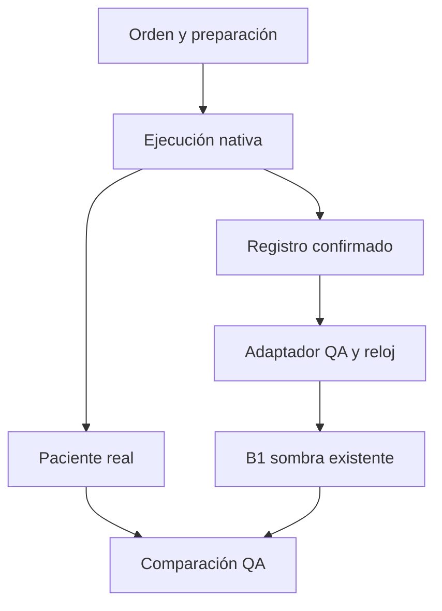

# ATRIA 4.8.7 — Checkpoint 1: flujo clínico observado

Base remota verificada: `9f6256e8bedfff0183a058313f34b3da1d24c5c3`, árbol `f2c50b67411415c44150dfc97fa3d4d9627e2c1a`, CI [38109160838](https://github.com/javierdario48-star/ATRIA/actions/runs/38109160838) SUCCESS. Sin commits posteriores al recuperar. Se leyeron los cinco documentos de continuidad. Estado de esta entrega: **observador QA implementado, OFF por defecto, sin activación clínica**. La publicación y el CI exactos se registran en el cierre posterior.

## Cambio mínimo y propiedad de los efectos

**Evidencia del repositorio:** la administración efectiva acaba en `recordAdministration`; las órdenes pueden permanecer en preparación o pendientes de acceso IV. Se observan sólo ese punto y `updateSimulation` mediante dos envolturas que llaman las funciones anteriores con los mismos argumentos, contexto, retorno y excepciones. El adaptador no escribe en `sim`, en `C`, en la enfermera ni en los monitores. No toca fisiología, parámetros B1, indicaciones ni catálogo. El motor nativo sigue siendo el único responsable del paciente real; el integrador B1 existente es el único escritor de la copia sombra.

**Ingeniería:** capturar el recibo en ese límite evita confundir chat, orden o aceptación con ejecución. Dosis/unidad históricas se cotejan con la ejecución; ID de paciente, secuencia y reloj explícito pasan por el adaptador tipado ya existente. Una exposición alimenta los múltiples mecanismos B1 registrados, sin un segundo efecto sobre el paciente. No se recorren tratamientos inactivos.

**Supuesto pendiente:** la fila nativa no contiene una formulación/vía explícita. Para las cinco definiciones piloto se comprueban dosis, unidades y acceso IV; se registra `nativeEvidence.routeSource=pilot-definition-with-native-dose-and-access`. La vía omitida se asume según B1 y no constituye prueba independiente de vía física. Una vía explícita desconocida o conflictiva en el texto del ledger se rechaza. El parser heredado puede descartar calificadores antes del ledger; no se alteró enfermería para inventar una evidencia que no existe. Esta limitación impide usar estos recibos para autorizar un escritor clínico nuevo.



## Uso y rollback

El build añade una sola entrada inline que define `window.csPhysiologyQA487`. No importa B1 ni instala envolturas hasta la llamada explícita. No hay parámetros de URL, almacenamiento persistente, activación automática, render extra, intervalos ni servicios nuevos.

```js
// Sólo sobre un paciente nuevo/untreated, visible, solo o aprendiz,
// de PERI-SEC-001, HDA-001 o CIRR-001, antes de avanzar el reloj.
await window.csPhysiologyQA487.enable();
const comparison = window.csPhysiologyQA487.report();
window.csPhysiologyQA487.disable();
```

Se rechazan pacientes con tiempo/historia/tratamientos previos y modos compartidos. No hay replay de guardias activas. El reloj observa tasas nativas 0,12/0,03 y conserva el ritmo del juego; un segundo activo equivale a un minuto clínico del piloto. El núcleo mantiene su grilla de 0,25 minutos; las muestras declaran tiempo solicitado e integrado.

Se registran bolos, inicio de soporte/infusión y modificaciones de dosis absoluta. Una suspensión nativa sin recibo confirmado **detiene la sombra**, sin fabricar un stop ni revertir un bolo. También la detienen cambios de paciente/endpoint, una pausa oculta, saltos de reloj, dosis modificadas fuera del ledger, historial perdido o datos inválidos. Los errores QA no interrumpen la llamada nativa. `disable()` devuelve las dos referencias originales sólo si la envoltura todavía le pertenece; no pisa a un adaptador posterior.

Capacidades: 256 muestras, 2.048 recibos/cola de captura y hasta 128 segmentos del reloj existente. No hay compactación/replay de sesiones mayores: se exige reiniciar desde un paciente nuevo. El número de muestras está acotado; estos límites no garantizan un máximo fijo de bytes para texto de órdenes arbitrariamente largo.

Rollback de código: revertir el commit funcional elimina la única entrada y el paquete de módulos QA; el contenido previo vuelve a los bytes originales. No hay estado clínico nuevo que migrar, efectos reales que deshacer ni deployment realizado.

## Pruebas y evidencia verificable

- `physiology-qa-observer-487.test.js`: **22 checks**, incluyendo 15 administraciones reales de funciones de enfermería (cinco por caso), pendientes sin efecto, colocación efectiva de vías/monitor, orden combinada, repetición, titulación, typing, truncamiento nativo a 80 filas, aislamiento/rollback, suspensión incompleta, bypass de ledger y vías conflictivas. La trayectoria completa de cada tratamiento coincide con replay del B1 aprobado.
- `physiology-qa-bootstrap-487.test.js`: **6 checks**; OFF conserva callbacks/no importa módulos, enable concurrente instala una vez, disable durante import cancela, fallo de carga/reinicio conserva diagnóstico y el HTML previo no cambia.
- `qa:physiology-live`: 24 trayectorias actuales de enfermería, 216 puntos con igualdad exacta del estado nativo ON/OFF, 9 tiempos hasta 125 minutos clínicos/125 segundos activos, individuales/combinadas/sin tratamiento. El informe legible y el JSON se guardan en el commit de resultados, sin reemplazar los snapshots aprobados.
- Suite completa `npm test` exit0: mantiene snapshots nativos (4.537 valores), B1 (30.351 comparaciones), expectativas clínicas independientes, reutilización sintética de molécula/caso, rechazo de mecanismos incompletos, bots existentes, enfermería, voz, supervivencia/rescate, Cirugía, XP/producto y multijugador. No se rehízo la investigación de 1.005 definiciones; su bot sigue como regresión.
- Build y `qa:physiology-artifact` exit0. HTML nuevo SHA-256 `92cf3df698f60714c9056562be489cd421e44f49788473bcd3b31522935081c3`; al quitar **únicamente** la entrada QA conserva `dc59039a59220582a1f5c86fcd8a2a0227c1cd3868550ba34a290049b94ef9c7`. 71 scripts inline válidos, 11 externos idénticos al golden master, 10 módulos locales comprobados byte a byte y dependencias resueltas sin CDN. El CI verifica este artefacto además del build.
- Revisión independiente encontró dos brechas: vías abreviadas/desconocidas aceptadas como IV, y una administración observada que podía esconder una escritura anterior externa en el ledger. Se corrigieron con regresiones y segunda revisión verde. Se corrigió además el diagnóstico obsoleto al fallar un reinicio de bootstrap; no se cambiaron coeficientes clínicos para aprobar.

Alcance real: VM de funciones generadas **del HEAD actual**, con timers deterministas y cola/completado de enfermería nativos. DOM/pathfinding/transporte/voz son fixtures; no prueba de navegador completo, dispositivo físico, guardia entera, reconocimiento de micrófono ni autoridad multijugador. El horizonte termina dentro de protección temprana: no certifica mortalidad posterior.

## Cobertura real de las 30 entradas

Fuente sin cambios: `qa/pharmacology-infrastructure/coverage-487.json`, generado desde30 entradas postarranque y 13 casos. Estas son entradas terapéuticas, no 30 moléculas. **Cinco ejecutables en sombra;25 sin implementar en B1; ninguna promovida al paciente real.** Las reglas nativas continúan funcionando como antes; “bloqueada” abajo se refiere al nuevo motor compartido.

| ID | Clasificación | Estado compartido / dependencia faltante |
|---|---|---|
| oxygen | Gas/soporte | Sombra B1; respuesta limitada, sin CO₂ |
| fluid | Clase de fluidos | Sombra B1; definición de cristaloide balanceado, sin equivalencia validada de todas las soluciones |
| vasopressor | Orden de clase | Sombra sólo con identidad noradrenalina; no todos los vasopresores |
| morphine | Molécula | Sombra B1; tres efectos, pico analgesia/SNC aún por calibrar |
| furosemide | Molécula | Sombra B1; diuresis/volumen/congestión según estado |
| albumin | Biológico | Bloqueada: presión oncótica/permeabilidad y mecanismo coloide |
| transfusion | Hemoderivado | Bloqueada: Hb/transporte de O₂, reacción y evento completado |
| espironolactona | Molécula | Bloqueada: aldosterona/Na/K y dinámica lenta |
| beta_blocker | Orden de clase | Bloqueada: molécula, cronotropismo/conducción/presión portal |
| stop_beta_blocker | Suspensión | Bloqueada: exposición objetivo y stop efectivamente confirmado |
| paracentesis_ter | Procedimiento | Bloqueada: ascitis/presión abdominal y drenaje realizado |
| ceftriaxone | Molécula | Bloqueada: susceptibilidad/carga/exposición/foco compartidos |
| metronidazole | Molécula | Bloqueada: susceptibilidad/carga/exposición/foco compartidos |
| imipenem | Combinación | Bloqueada: identidad/formulación y mecanismo antimicrobiano |
| ceftazidime | Molécula | Bloqueada: mecanismo antimicrobiano/PK |
| cefoperazone | Molécula | Bloqueada: antimicrobiano y toxicidad/coagulación |
| cefepime | Molécula | Bloqueada: antimicrobiano y neurotoxicidad contextual |
| piptazo | Combinación | Bloqueada: componentes/formulación y antimicrobiano |
| ampicillin | Molécula | Bloqueada: antimicrobiano/PK |
| amikacin | Molécula | Bloqueada: antimicrobiano, lesión renal/auditiva |
| gentamicin | Molécula | Bloqueada: antimicrobiano, lesión renal/auditiva |
| fluconazole | Molécula | Bloqueada: susceptibilidad fúngica, QT/lesión hepática |
| amphotericin | Molécula | Bloqueada: formulación, susceptibilidad fúngica, renal/K/Mg |
| analgesia | Orden genérica | Bloqueada: elegir molécula; los mecanismos opioides no representan paracetamol |
| antiemetic | Orden genérica | Bloqueada: molécula, náusea/motilidad/QT |
| ppi | Clase | Bloqueada: molécula/ácido/estabilidad del coágulo/sangrado |
| steroid | Clase | Bloqueada: molécula, inmunidad/glucosa y latencia |
| aza | Molécula | Bloqueada: inmunomodulación lenta/reserva medular |
| anticoagulation | Heparina IV del arranque | Bloqueada: coagulación/trombo/sangrado/plaquetas/aPTT/PK y validación |
| source_control | Procedimiento | Bloqueada: estado del foco y evidencia de realización; consulta aceptada no basta |

Heparina: no se añadió ni se modificó su ficha. La prueba estricta `pharmacology-boot-487.test.js --require-compatible` conserva exit1 por `anticoagulation`, con fallback transaccional seguro. Suite verde significa que ese rechazo esperado está probado, no que se haya activado la farmacología global.

## Cobertura de casos

| Caso existente | Perfil compartido / estado de esta entrega |
|---|---|
| PERI-SEC-001 | B1 y flujo observado; soporte sin control del foco/infección |
| HDA-001 | B1 y flujo observado; sangrado continúa, Hb todavía ausente |
| CIRR-001 | B1 y flujo observado; congestión/volemia/renal simplificados, no cirrosis completa |
| PERI-PBE-001 | Nativo preservado; falta perfil compartido e infección/foco |
| PERI-TER-001 | Nativo preservado; falta perfil compartido e infección/resistencia/foco |
| CHOLANG-001 | Nativo preservado; falta perfil compartido y foco biliar |
| APP-001 | Nativo preservado; falta perfil compartido e infección/foco |
| CHOLE-001 | Nativo preservado; falta perfil compartido y foco biliar |
| PANC-001 | Nativo preservado; falta perfil compartido/tercer espacio y validación de fase |
| ILEO-001 | Nativo preservado; falta motilidad/obstrucción/descompresión |
| MESI-001 | Nativo preservado; falta perfusión intestinal/trombosis/coagulación |
| CROHN-001 | Nativo preservado; falta inflamación intestinal/inmunidad y tiempos lentos |
| COLON-001 | Nativo preservado; falta anemia/obstrucción/evolución oncológica lenta |

Se reutilizan exactamente los siete mecanismos anteriores: `volume`, `pressor`, `oxygenation`, `diuretic`, `opioid-analgesia`, `opioid-respiratory`, `opioid-circulation`. **Cero mecanismos nuevos, cero enfermedades nuevas, cero moléculas nuevas.** Los sintéticos siguen siendo pruebas de contrato, no contenido publicado.

## Bloqueo de Checkpoint 2 y handoff obligatorio

**Evidencia concreta:** la generación nativa `updateLiveVitals` usa `updatePhysiologyState`, `therapyEffectTotals`, `progressionOffsets` y `medicationSafetyOffsets` antes de escribir `sim.liveVitals`. `src/integration/critical-rescue-487.js` vuelve a envolver `updatePhysiologyState` y actúa sobre `sim.phys`; su predicado de muerte lee los mismos signos y evidencia administrada. `src/integration/secondary-sepsis-bridge-487.js` usa esas mismas variables y el estado de soporte/consulta para el pase quirúrgico. `src/integration/grace-survival-487.js` lee esos signos/evidencia y controla `_fatalExposure` con relojes protegidos.

Por tanto, no es seguro sumar B1 ni sustituir `sim.phys/liveVitals` para “activar sólo el monitor”: cambiaría entradas de rescate/supervivencia/derivación; conservar todos los efectos nativos además de B1 los duplicaría. El observador demuestra aislamiento de escritura, **no** separación de esos consumidores. Según la regla de parada solicitada, **Checkpoint 2 permanece detenido y Checkpoints 3–5 pendientes**. No se preparó un flag que aparente resolver este conflicto.

**Siguiente cambio acotado propuesto, todavía sin implementar:** completar recibos veraces de vía/formulación y suspensión en el límite efectivo del ejecutor, con tests del parser/ledger; después establecer, por cada mecanismo B1 y caso limitado, un solo responsable y un contrato de lectura para los consumidores protegidos. Antes de habilitar escritura, demostrar igualdad de protección/gracia/rescate/derivaciones y ausencia de efectos duplicados en ventanas anteriores y posteriores a la protección. Si exige cambiar un sistema prohibido, no cabe dentro de esta autorización.

**Contenido posterior:** sólo tras ese gate, familias por dependencias. Primer grupo infeccioso propuesto ceftriaxona+metronidazol con susceptibilidad/exposición/foco realizados; sin una ecuación por antibiótico. No activar las otras 25 entradas mediante aliases o beneficios fijos. Las fichas/reglas nuevas requerirán fuentes actuales y expectativas independientes; las fuentes B1 previas no validan antimicrobianos/heparina.

Riesgos pendientes: calibración médica de magnitudes/tiempos, vías omitidas y calificadores perdidos, stops incompletos, pacientes activos/replay, suspensión de pestañas/guardia completa, autoridad multijugador, navegador/móvil físico y presupuestos de memoria/CPU. La ruta heredada de oxígeno puede anunciar “NO administrado” durante preparación y administrarlo después; se conservó y el observador usa el recibo real. CI no certifica realismo médico.
