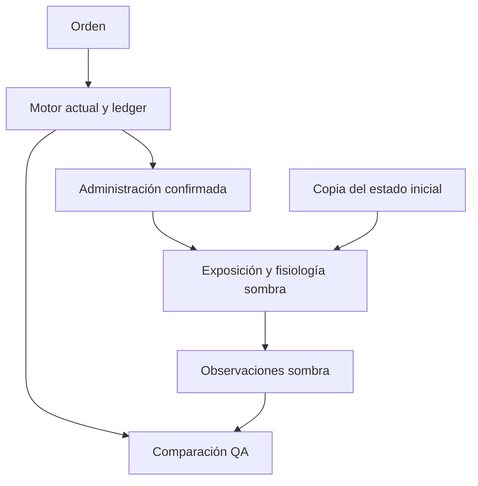

# ATRIA B1 — comparación fisiológica aislada

Baseline: `7d761ee69ebd05bd8a403babae104e5ca78b26d6`. Modelo: `b1-shadow-1`. No hay activación clínica, escritura en pacientes, despliegue ni validación médica de magnitudes.

## Reloj y alcance

24 trayectorias nativas y 120 muestras congeladas; 34 escenarios nuevos por caso, 102 trayectorias y 1.122 muestras hasta 360 minutos clínicos. Las órdenes nativas se convierten exclusivamente después de administrarse.
Comparación sin escribir mientras el motor actual sigue siendo responsable del paciente. QA de VM/replay, sin instalación automática en el navegador. El adaptador global sigue rechazado por heparina.

El motor antiguo usa 0,12 minutos nativos por segundo real (0,03 al escribir); la guardia comprime un minuto clínico en un segundo real. La comparación divide por 0,12 con escritura desactivada. El núcleo integra cada 0,25 minutos clínicos y conserva el resto; la muestra declara ambos tiempos. No se corrige ningún reloj existente.

## Misma administración: motor actual frente a sombra

Última muestra: 125 minutos clínicos, 15 minutos nativos, 125 segundos reales, dentro de protección de muerte temprana. PA sistólica/diastólica · FC · FR · SpO₂. Diferencia numérica no demuestra superioridad clínica.

| Caso | Escenario | Actual | Sombra | Δ PAM | Δ SpO₂ |
|---|---|---|---|---:|---:|
| PERI-SEC-001 | untreated | 55.0/30.0 · 168.1 · 36.6 · 89.6 | 47.5/26.2 · 153.1 · 33.7 · 88.8 | -5.1 | -0.9 |
| PERI-SEC-001 | oxygen | 55.0/30.0 · 168.1 · 34.4 · 96.3 | 47.5/26.2 · 153.1 · 33.7 · 90.8 | -5.1 | -5.5 |
| PERI-SEC-001 | fluid | 55.0/30.0 · 167.9 · 36.6 · 89.6 | 50.1/27.6 · 152.0 · 34.3 · 87.7 | -3.2 | -2.0 |
| PERI-SEC-001 | vasopressor | 56.4/37.1 · 165.1 · 36.6 · 89.6 | 64.1/42.8 · 143.1 · 33.7 · 88.8 | 6.4 | -0.9 |
| PERI-SEC-001 | morphine | 55.0/30.0 · 164.1 · 34.1 · 89.6 | 43.0/22.3 · 151.5 · 32.2 · 87.2 | -9.1 | -2.4 |
| PERI-SEC-001 | furosemide | 55.0/30.0 · 168.2 · 36.6 · 89.6 | 44.8/24.7 · 154.2 · 33.7 · 88.8 | -6.9 | -0.9 |
| PERI-SEC-001 | combined-support | 56.7/37.2 · 164.9 · 34.4 · 96.3 | 67.6/45.2 · 141.5 · 34.3 · 90.2 | 9.0 | -6.1 |
| PERI-SEC-001 | fluid-plus-diuretic | 55.0/30.0 · 168.1 · 36.6 · 89.6 | 47.2/26.1 · 153.2 · 34.3 · 87.7 | -5.2 | -2.0 |
| HDA-001 | untreated | 82.3/52.4 · 129.0 · 25.7 · 95.8 | 80.0/49.3 · 124.3 · 22.0 · 97.0 | -2.8 | 1.2 |
| HDA-001 | oxygen | 82.3/52.4 · 129.0 · 23.7 · 100.0 | 80.0/49.3 · 124.3 · 22.0 · 97.0 | -2.8 | -3.0 |
| HDA-001 | fluid | 103.1/62.7 · 110.6 · 22.5 · 96.5 | 88.7/54.7 · 120.4 · 22.2 · 96.5 | -10.1 | 0.0 |
| HDA-001 | vasopressor | 102.3/62.4 · 125.0 · 25.7 · 95.8 | 97.7/70.4 · 112.3 · 22.0 · 97.0 | 3.8 | 1.2 |
| HDA-001 | morphine | 82.3/52.4 · 124.0 · 22.7 · 95.8 | 72.3/42.5 · 127.8 · 20.5 · 95.5 | -9.9 | -0.3 |
| HDA-001 | furosemide | 76.3/49.4 · 134.0 · 25.7 · 95.8 | 73.9/45.6 · 127.0 · 22.0 · 97.0 | -3.3 | 1.2 |
| HDA-001 | combined-support | 123.1/72.7 · 106.6 · 20.5 · 100.0 | 108.4/78.1 · 107.1 · 22.2 · 96.5 | -1.3 | -3.5 |
| HDA-001 | fluid-plus-diuretic | 97.1/59.7 · 115.6 · 22.5 · 96.5 | 82.7/51.1 · 123.0 · 22.2 · 96.6 | -10.5 | 0.1 |
| CIRR-001 | untreated | 108.0/68.0 · 94.0 · 20.0 · 96.0 | 108.0/68.0 · 94.0 · 20.0 · 96.0 | 0.0 | 0.0 |
| CIRR-001 | oxygen | 108.0/68.0 · 94.0 · 18.0 · 100.0 | 108.0/68.0 · 94.0 · 20.0 · 96.0 | 0.0 | -4.0 |
| CIRR-001 | fluid | 122.0/75.0 · 82.0 · 19.0 · 96.0 | 111.5/70.2 · 92.4 · 20.2 · 95.5 | -6.7 | -0.5 |
| CIRR-001 | vasopressor | 128.0/78.0 · 90.0 · 20.0 · 96.0 | 148.7/108.7 · 74.0 · 20.0 · 96.0 | 27.3 | 0.0 |
| CIRR-001 | morphine | 108.0/68.0 · 89.0 · 17.0 · 96.0 | 97.0/58.3 · 99.5 · 18.3 · 94.3 | -10.1 | -1.7 |
| CIRR-001 | furosemide | 102.0/65.0 · 99.0 · 20.0 · 96.0 | 108.0/68.0 · 94.0 · 20.0 · 96.0 | 4.0 | 0.0 |
| CIRR-001 | combined-support | 142.0/85.0 · 78.0 · 17.0 · 100.0 | 153.4/112.1 · 74.0 · 20.2 · 95.8 | 21.9 | -4.2 |
| CIRR-001 | fluid-plus-diuretic | 116.0/72.0 · 87.0 · 19.0 · 96.0 | 108.0/68.0 · 94.0 · 20.1 · 95.7 | -5.3 | -0.3 |

## Beneficio, daño y evolución del modelo nuevo

Estos son escenarios de soporte y contrafactuales del simulador. Ninguna de estas cinco intervenciones realiza hemostasia o control del foco. El tratamiento completo de sepsis/HDA/ascitis excede B1.

| Caso | Escenario | PA · FC · FR · SpO₂ a 60 min | Volumen efectivo mL a 60 min | Perfusión a 60 min | Diuresis acumulada a 360 min mL | Eventos de riesgo modelados |
|---|---|---|---:|---:|---:|---|
| PERI-SEC-001 | untreated | 68.3/38.8 · 139.8 · 31.7 · 90.6 | 2490.7 | 0.3 | 0.0 | fluid-overload |
| PERI-SEC-001 | fluid-reference | 71.1/40.3 · 138.6 · 32.3 · 89.5 | 2590.2 | 0.4 | 0.0 | fluid-overload |
| PERI-SEC-001 | fluid-repeat | 99.3/56.4 · 126.6 · 35.8 · 82.4 | 3621.2 | 0.6 | 0.0 | fluid-overload |
| PERI-SEC-001 | pressor-high | 116.5/86.9 · 111.8 · 31.7 · 90.6 | 2490.7 | 0.3 | 0.0 | pressor-excess, fluid-overload |
| PERI-SEC-001 | morphine-repeat | 59.0/30.7 · 139.1 · 24.1 · 83.0 | 2490.7 | 0.3 | 0.0 | opioid-respiratory-depression, fluid-overload |
| PERI-SEC-001 | renal-morphine | 61.0/32.4 · 139.2 · 29.4 · 88.3 | 2490.7 | 0.3 | 0.0 | fluid-overload |
| PERI-SEC-001 | diuretic-reference | 66.1/37.5 · 140.7 · 31.7 · 90.6 | 2410.6 | 0.3 | 103.1 | diuretic-hypoperfusion, fluid-overload |
| PERI-SEC-001 | renal-diuretic | 68.0/38.6 · 140.0 · 31.7 · 90.6 | 2477.1 | 0.3 | 20.7 | diuretic-hypoperfusion, fluid-overload |
| PERI-SEC-001 | congestion-fluid | 81.4/46.2 · 134.2 · 34.5 · 85.0 | 5193.7 | 0.8 | 0.0 | fluid-overload |
| PERI-SEC-001 | congestion-diuretic | 72.7/41.3 · 137.9 · 31.7 · 90.6 | 4637.5 | 0.6 | 206.9 | diuretic-hypoperfusion, fluid-overload |
| PERI-SEC-001 | combined-support | 100.1/68.2 · 121.7 · 32.8 · 90.6 | 2690.7 | 0.5 | 0.0 | fluid-overload |
| HDA-001 | untreated | 87.3/53.8 · 121.0 · 22.0 · 97.0 | 3110.0 | 0.6 | 0.0 | — |
| HDA-001 | fluid-reference | 92.4/57.0 · 118.7 · 22.4 · 96.2 | 3292.0 | 0.7 | 0.0 | — |
| HDA-001 | fluid-repeat | 122.3/75.5 · 105.3 · 26.2 · 88.6 | 4360.0 | 0.9 | 0.0 | fluid-overload |
| HDA-001 | pressor-high | 111.9/87.2 · 102.7 · 22.0 · 97.0 | 3110.0 | 0.3 | 0.0 | pressor-excess |
| HDA-001 | morphine-repeat | 75.0/43.0 · 126.8 · 14.5 · 89.5 | 3110.0 | 0.5 | 0.0 | opioid-respiratory-depression |
| HDA-001 | renal-morphine | 77.5/45.2 · 125.6 · 19.7 · 94.7 | 3110.0 | 0.5 | 0.0 | — |
| HDA-001 | diuretic-reference | 82.6/51.0 · 123.1 · 22.0 · 97.0 | 2944.7 | 0.6 | 218.8 | diuretic-hypoperfusion |
| HDA-001 | renal-diuretic | 86.6/53.5 · 121.3 · 22.0 · 97.0 | 3088.1 | 0.6 | 40.1 | diuretic-hypoperfusion |
| HDA-001 | congestion-fluid | 94.0/58.0 · 118.0 · 25.4 · 90.3 | 5560.0 | 1.1 | 0.0 | fluid-overload |
| HDA-001 | congestion-diuretic | 88.9/54.9 · 120.3 · 22.0 · 97.0 | 4966.2 | 1.0 | 296.7 | — |
| HDA-001 | combined-support | 115.1/83.0 · 103.8 · 22.9 · 95.7 | 3360.0 | 0.6 | 0.0 | — |
| CIRR-001 | untreated | 108.0/68.0 · 94.0 · 20.0 · 96.0 | 3900.0 | 0.8 | 0.0 | — |
| CIRR-001 | fluid-reference | 111.5/70.2 · 92.4 · 20.2 · 95.5 | 4025.0 | 0.8 | 0.0 | — |
| CIRR-001 | fluid-repeat | 142.6/89.8 · 78.4 · 22.1 · 91.8 | 5150.0 | 1.0 | 0.0 | — |
| CIRR-001 | pressor-high | 164.0/129.2 · 74.0 · 20.0 · 96.0 | 3900.0 | 0.5 | 0.0 | pressor-excess |
| CIRR-001 | morphine-repeat | 92.7/54.4 · 101.7 · 12.2 · 88.2 | 3900.0 | 0.7 | 0.0 | opioid-respiratory-depression |
| CIRR-001 | renal-morphine | 95.7/57.1 · 100.2 · 17.5 · 93.5 | 3900.0 | 0.8 | 0.0 | — |
| CIRR-001 | diuretic-reference | 108.0/68.0 · 94.0 · 20.0 · 96.0 | 3900.0 | 0.8 | 289.3 | — |
| CIRR-001 | renal-diuretic | 108.0/68.0 · 94.0 · 20.0 · 96.0 | 3900.0 | 0.8 | 52.7 | — |
| CIRR-001 | congestion-fluid | 108.0/68.0 · 94.0 · 22.0 · 92.0 | 5800.0 | 1.1 | 0.0 | — |
| CIRR-001 | congestion-diuretic | 108.0/68.0 · 94.0 · 20.4 · 95.2 | 5300.0 | 1.1 | 296.7 | — |
| CIRR-001 | combined-support | 158.2/115.6 · 74.0 · 20.4 · 95.6 | 4150.0 | 0.8 | 0.0 | — |

## Tiempos del modelo y calibración pendiente

| Caso | Medicamento IV | Pico calculado en minutos clínicos | Endpoint |
|---|---|---:|---|
| PERI-SEC-001 | morphine | 41.0 | shared-opioid-effect |
| PERI-SEC-001 | furosemide | 20.3 | urine-rate |
| HDA-001 | morphine | 40.0 | shared-opioid-effect |
| HDA-001 | furosemide | 23.0 | urine-rate |
| CIRR-001 | morphine | 42.8 | shared-opioid-effect |
| CIRR-001 | furosemide | 25.0 | urine-rate |

Furosemida se contrasta con el pico de diuresis regulatorio dentro de 30 minutos. El compartimento compartido de morfina **no distingue pico analgésico del pico de depresión del SNC**: sus picos aproximados de 40–45 minutos requieren revisión frente a endpoints regulatorios diferentes (analgesia IV dentro de 20 minutos en la ficha DBL; máximo SNC puede demorarse aproximadamente 30 minutos). No se declara validado ese tiempo ni se ajustaron ganancias para aprobar comparaciones contra el motor antiguo.

## Arquitectura y API

Funciones puras, definiciones inmutables indexadas por ID, PK analítica y fisiología no lineal sobre una grilla fija. Las variables internas son volumen circulante/intersticial, tono vascular, bomba, perfusión, intercambio gaseoso, soporte de oxígeno, riesgo de sobrecarga, dolor, depresión respiratoria/sedación, función renal/hepática, inflamación/infección, estado de foco e isquemia. PA, FC, FR, SpO₂ y temperatura se derivan después; no son la entrada del efecto farmacológico.



```js
const state = createPhysiologyState487(profile, 'patient-id');
const next = stepPhysiology487(state, administeredEvents, deltaClinicalMinutes, definitions);
const signs = observePhysiology487(next);
const shadow = createPhysiologyShadow487(caseDef, initialPatient, {clock: {mode: 'native-no-typing', nativeMinutesPerClinicalMinute: 0.12}});
const sampled = samplePhysiologyShadow487(shadow, patientSnapshot, {typing: false});
```

El contrato de evento contiene `eventId`, `patientId`, `drugId`, `status:administered`, acción, vía, dosis/unidad, minuto clínico y secuencia. Duplicados idénticos no actúan otra vez; payloads conflictivos o administraciones tardías nuevas exigen replay. Detener una infusión elimina su entrada, mientras detener bolos futuros no deshace un bolo recibido. Parámetros y nuevas dependencias están documentados en `parameters-487.md` y en el plan de escalabilidad.

## Lectura y límites

- PERI-SEC: soporte puede elevar presión u oxigenación mientras siguen infección, inflamación y fuga capilar; el foco permanece sin controlar.
- HDA: fluidos pueden mejorar presión; la pérdida de sangre continúa. Diuréticos agravan la depleción y el modelo todavía no representa Hb/transporte de oxígeno.
- CIRR: el líquido intersticial puede disminuir con diuresis, sin curación instantánea de cirrosis/ascitis; el fallo renal reduce respuesta. Volemia efectiva baja y ascitis pueden coexistir.
- La dosis alta/repetida puede mostrar riesgos; exposición excesiva de noradrenalina eleva presión sin garantizar perfusión, morfina reduce dolor y ventilación.
- En HDA/CIRR no existe volumen/perfusión nativos que comparar; el JSON conserva `nativePhysiology:null`.
- El historial antiguo se limita a80 filas y no suministra suspensiones completas. Para esos escenarios el núcleo recibe eventos tipados explícitos; no se infiere suspensión desde la última dosis.
- Aún pendientes: calibración profesional de magnitudes y picos, hemoglobina/CO₂/electrolitos, balance renal ordinario, resistencia/antimicrobianos/control real del foco, muerte posprotección y Android/iOS físico.
- Superioridad demostrada: propiedad informática de reutilización y efectos finitos dependientes del estado; ausencia de bonificación de oxígeno en normoxemia y separación de diuresis/ascitis de una penalización fija de PA. **Superioridad cuantitativa clínica todavía no demostrada.**

## Reproducción

`npm run qa:physiology-pilot` genera el análisis en memoria. `npm run qa:physiology-pilot -- --write` actualiza explícitamente este informe y su JSON. Los tests no regeneran snapshots.
`npm run qa:physiology-benchmark` mide exclusivamente Node. Las hipótesis clínicas independientes y sus fuentes están en `clinical-expectations-487.json` y `ATRIA_487_PHYSIOLOGY_PILOT_EVIDENCE.md`.

## Rendimiento medido

Node v24.19.0, linux/x64, AMD EPYC 9V74 80-Core Processor. Núcleo solamente; sin renderizado, motor antiguo, red o retención de muestras sombra. No es Android/iOS físico. 100 pasos de calentamiento y 600 mediciones por escenario.

| Pacientes | Intervenciones | Definiciones instaladas | p50 lote ms | p95 lote ms | p99 lote ms |
|---:|---:|---:|---:|---:|---:|
| 1 | 2 | 5 | 0.010 | 0.023 | 0.049 |
| 1 | 5 | 5 | 0.010 | 0.014 | 0.039 |
| 16 | 2 | 5 | 0.070 | 0.166 | 0.274 |
| 16 | 5 | 5 | 0.082 | 0.157 | 0.254 |
| 64 | 2 | 5 | 0.201 | 0.358 | 0.451 |
| 64 | 5 | 5 | 0.253 | 0.429 | 0.571 |
| 64 | 2 | 305 | 0.208 | 0.463 | 0.562 |

Heap retenido estimado con GC: 3559.7 bytes/paciente (2000 pacientes). Estado JSON típico: 2706 bytes; con 2.048 recibos: 163178 bytes. Son medidas distintas; el historial tiene un límite explícito y requiere checkpoints antes de ampliar retención en móvil.

El tick cuesta O(pacientes × (fármacos activos + mecanismos activos + eventos pendientes acotados)). Compilar el catálogo cuesta O(definiciones) una vez. Copiar el índice de deduplicación cuesta O(historial) únicamente al ingresar nuevos recibos; no se recorre en cada tick. El observador QA retiene hasta 256 muestras y no satisface por sí solo un presupuesto de memoria de ejecución móvil. Los presupuestos y ensayos de dispositivo pendientes están en el plan de escalabilidad.
